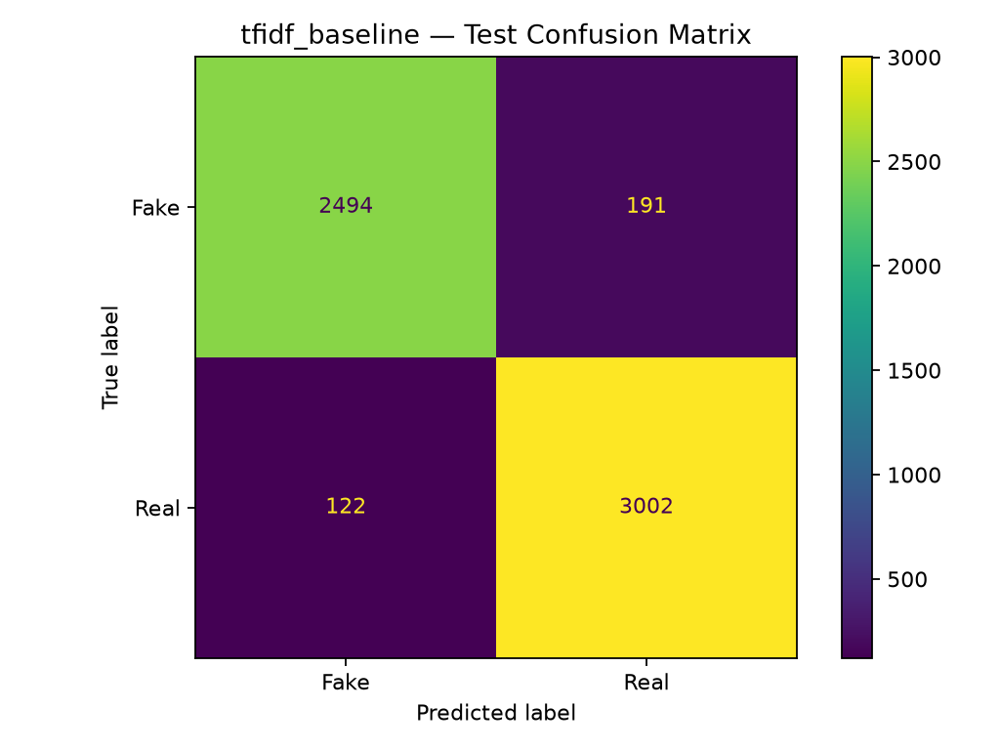
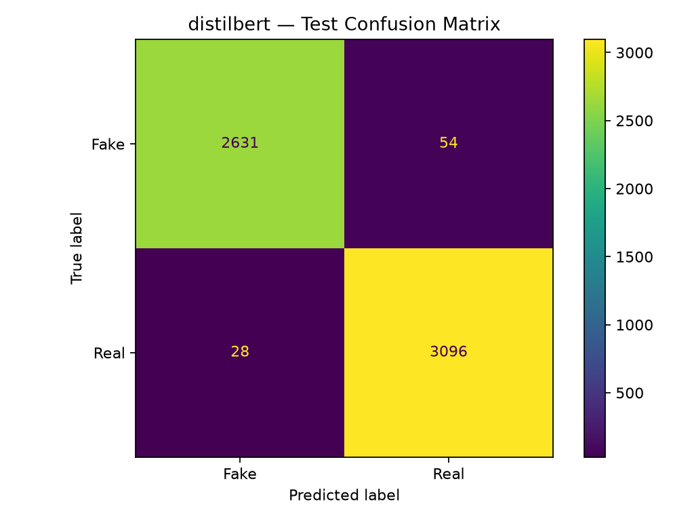

# Fake News Headline Classifier

**An NLP and Applied AI project comparing TF-IDF + Logistic Regression with fine-tuned DistilBERT for binary headline classification.**

This project explores how traditional machine learning and transformer-based NLP models classify news headlines as `Fake` or `Real`. It includes dataset auditing, preprocessing, exploratory data analysis, model training, evaluation, error analysis, explainability, and an interactive Streamlit application.

> **Important:** This is an experimental headline classifier, not a fact-checking system. Predictions reflect patterns learned from the training data and do not independently establish whether a claim is true.

## Project Highlights

- Compared a TF-IDF + Logistic Regression baseline with fine-tuned DistilBERT.
- Achieved **98.59% test accuracy** with DistilBERT on the held-out test set.
- Implemented stratified train, validation, and test splits with headline-overlap checks.
- Added LIME explanations for the TF-IDF baseline.
- Built an interactive Streamlit application for single-headline and batch CSV prediction.
- Added automated tests for prediction outputs and CSV validation.
- Documented model errors, external challenge failures, and evaluation limitations.

## Model Performance

Both models were evaluated on the same held-out test set of 5,809 headlines.

| Metric | TF-IDF + Logistic Regression | DistilBERT |
|---|---:|---:|
| Accuracy | 94.61% | **98.59%** |
| Macro Precision | 94.68% | **98.62%** |
| Macro Recall | 94.49% | **98.55%** |
| Macro F1-score | 94.57% | **98.58%** |
| Misclassified headlines | 313 | **82** |

DistilBERT made 231 fewer errors than the TF-IDF baseline on this test set.

These results describe performance on this dataset and split. They should not be interpreted as real-world misinformation detection accuracy.

### Confusion Matrices

**TF-IDF + Logistic Regression**



**DistilBERT**



## Dataset

The project uses the ISOT Fake News Dataset, containing separate collections of fake and real news articles.

The current processed headline dataset contains **38,725 records** after preprocessing and duplicate/conflict handling.

| Dataset split | Headlines | Fake | Real |
|---|---:|---:|---:|
| Training | 27,107 | 12,531 | 14,576 |
| Validation | 5,809 | 2,685 | 3,124 |
| Test | 5,809 | 2,685 | 3,124 |
| **Total** | **38,725** | **17,901** | **20,824** |

The data pipeline includes missing-value checks, headline normalization, duplicate inspection, conflicting-label handling, and stratified splitting.

**Dataset considerations:**

- The source dataset may contain publisher-, topic-, and time-specific patterns.
- Random splitting does not guarantee generalization to unseen publishers or future news.
- Deduplicating normalized headlines may remove distinct articles that share the same headline.
- Obtain the dataset from its authorized source and follow its applicable license and usage terms. Raw dataset files are excluded from this repository.

## Models and Methodology

### 1. TF-IDF + Logistic Regression

The traditional ML baseline uses:

- TF-IDF features with unigrams and bigrams.
- A maximum vocabulary size of 100,000 features.
- Minimum document frequency of 2.
- Sublinear term frequency scaling.
- Logistic Regression with a maximum of 1,000 iterations.

This provides a lightweight baseline for comparison.

### 2. DistilBERT

The transformer model uses `distilbert-base-uncased` with a binary classification head.

- Maximum sequence length: 64 tokens.
- Batch size: 8 during training.
- Training epochs: 2.
- Learning rate: `2e-5`.
- Best checkpoint selected using validation performance.

The saved model is evaluated separately on the held-out test set.

### Evaluation discipline

The validation set is used during model development. The final test results are reserved for final reporting and should not be used for further hyperparameter tuning.

## Application Features

The Streamlit application provides:

- **Single-headline prediction:** classify a headline and display model scores.
- **Batch CSV prediction:** upload a CSV containing a `headline` column and download predictions.
- **LIME explainability:** inspect word-level contributions for the TF-IDF baseline.
- **Evaluation dashboard:** compare model metrics and view confusion matrices.
- **Input validation:** reject invalid CSV structures and limit uploads to 5,000 rows.

LIME explanations apply to the TF-IDF baseline, not DistilBERT. Displayed model confidence is not the probability that a headline is factually true.

## Error Analysis

The held-out test error analysis found:

| Error category | Count |
|---|---:|
| Both models correct | 5,471 |
| Both models wrong | 57 |
| TF-IDF wrong, DistilBERT correct | 256 |
| TF-IDF correct, DistilBERT wrong | 25 |

A separate external challenge set currently contains two manually labeled examples. DistilBERT incorrectly classified both death-claim headlines as Real, despite assigning each a confidence above 99%.

This small challenge set is not sufficient to estimate general real-world performance, but it illustrates why high test accuracy and confidence scores do not guarantee reliable factual judgments.

See [`docs/error_analysis.md`](docs/error_analysis.md) for the detailed analysis.

## Project Structure

```text
fake-news-headline-classifier/
├── app/
│   └── app.py
├── data/
│   ├── raw/                 # Local source dataset; not committed
│   ├── interim/
│   └── processed/           # Generated datasets; not committed
├── docs/
│   └── error_analysis.md
├── models/                  # Locally saved model artifacts
├── reports/
│   ├── figures/
│   ├── baseline_metrics.json
│   ├── final_test_metrics.json
│   ├── challenge_evaluation.json
│   ├── error_analysis_summary.json
│   └── test_error_analysis.csv
├── src/
│   └── fake_news/
│       ├── analyze_errors.py
│       ├── batch_predict.py
│       ├── data_audit.py
│       ├── evaluate_challenge.py
│       ├── evaluate_test.py
│       ├── explain_lime.py
│       ├── explore_dataset.py
│       ├── predict.py
│       ├── prepare_dataset.py
│       ├── split_dataset.py
│       ├── train_baseline.py
│       └── train_transformer.py
├── tests/
│   └── test_predict.py
├── README.md
└── requirements.txt
```

Some generated artifacts, local model checkpoints, and processed datasets are intentionally excluded from version control. Recreate them by following the project's pipeline.

## Installation

### Prerequisites

- Python 3.11
- Git
- A compatible environment for PyTorch and Transformers
- Optional NVIDIA GPU for faster transformer inference and training

### 1. Clone the repository

```bash
git clone <YOUR_GITHUB_REPOSITORY_URL>
cd fake-news-headline-classifier
```

Replace the placeholder with your actual GitHub repository URL.

### 2. Create and activate a virtual environment

**Windows PowerShell:**

```powershell
py -3.11 -m venv .venv
.\.venv\Scripts\Activate.ps1
python -m pip install --upgrade pip
```

### 3. Install dependencies

```powershell
pip install -r requirements.txt
```

### 4. Prepare the dataset

Obtain the authorized ISOT dataset and place its source files locally:

```text
data/raw/Fake.csv
data/raw/True.csv
```

Run the project's data-audit, preprocessing, and split-generation scripts in the appropriate order:

```powershell
python .\src\fake_news\data_audit.py
python .\src\fake_news\prepare_dataset.py
python .\src\fake_news\split_dataset.py
```

### 5. Train the models

Run the baseline and transformer training scripts:

```powershell
python .\src\fake_news\train_baseline.py
python .\src\fake_news\train_transformer.py
```

Transformer training can require substantial memory and time. The pretrained DistilBERT weights may also need to be downloaded, depending on your local cache.

### 6. Launch the application

After the required model artifacts have been generated or obtained:

```powershell
python -m streamlit run .\app\app.py --server.fileWatcherType none
```

Streamlit will display the local URL for opening the application in your browser.

## Running Tests

Run the complete test suite:

```powershell
python -m pytest -v
```

The current development environment has **8 passing tests**, covering prediction outputs, label validity, probability validity, empty-headline rejection, and CSV validation.

## Technology Stack

- **Language:** Python
- **Data processing:** Pandas, NumPy
- **Traditional ML:** scikit-learn, TF-IDF, Logistic Regression
- **Deep learning:** PyTorch, Hugging Face Transformers, DistilBERT
- **Explainability:** LIME
- **Visualization:** Matplotlib
- **Application:** Streamlit
- **Testing:** pytest
- **Version control:** Git

## Known Limitations

1. A headline alone does not provide sufficient evidence to establish factual truth.
2. Dataset-specific patterns may not generalize to current or independently sourced news.
3. High confidence can accompany an incorrect prediction.
4. The external challenge set is too small for broad conclusions.
5. Publisher-held-out and time-based evaluations are important future improvements.
6. Probability calibration and evidence retrieval require additional evaluation and development.

## Future Improvements

- Build a larger, independently verified external evaluation set.
- Evaluate generalization across publishers and publication periods.
- Add systematic topic-based error analysis.
- Evaluate probability calibration on a dedicated validation set.
- Explore retrieval-assisted verification using reliable sources.
- Add automated continuous integration for tests and code quality checks.

## Responsible Use

This project is intended for educational and research purposes. It should not be used as the sole basis for deciding whether a news story is true, sharing allegations, or making consequential decisions. Verify claims through credible sources and supporting evidence.

## License

Add a license only after choosing one that is compatible with your code, model dependencies, and dataset usage rights. The dataset may have separate terms from this repository.
